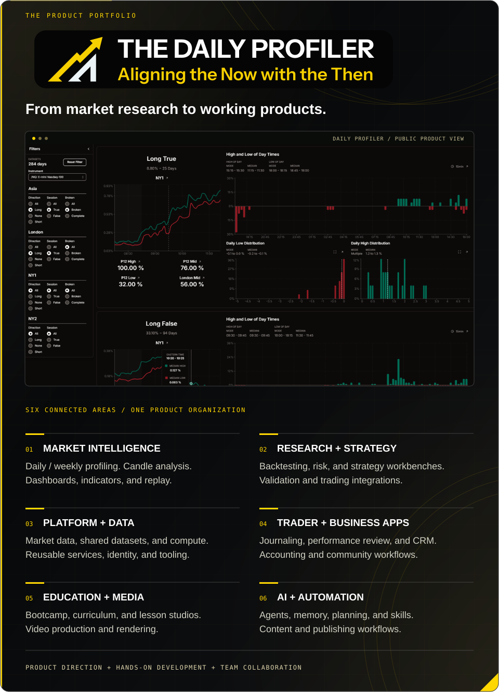
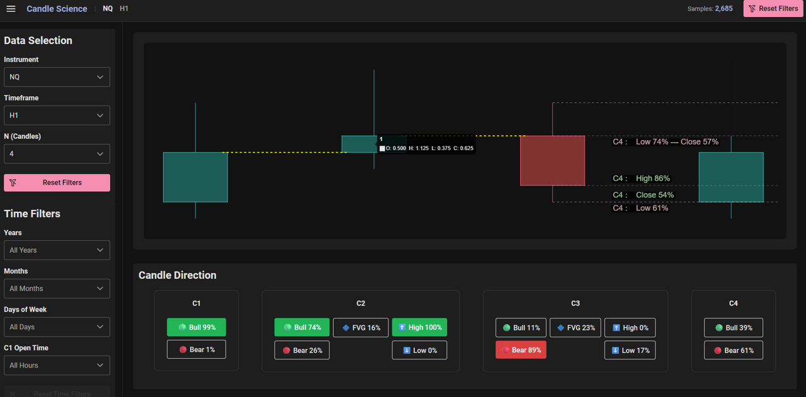
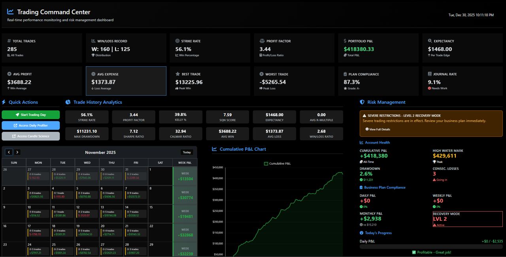
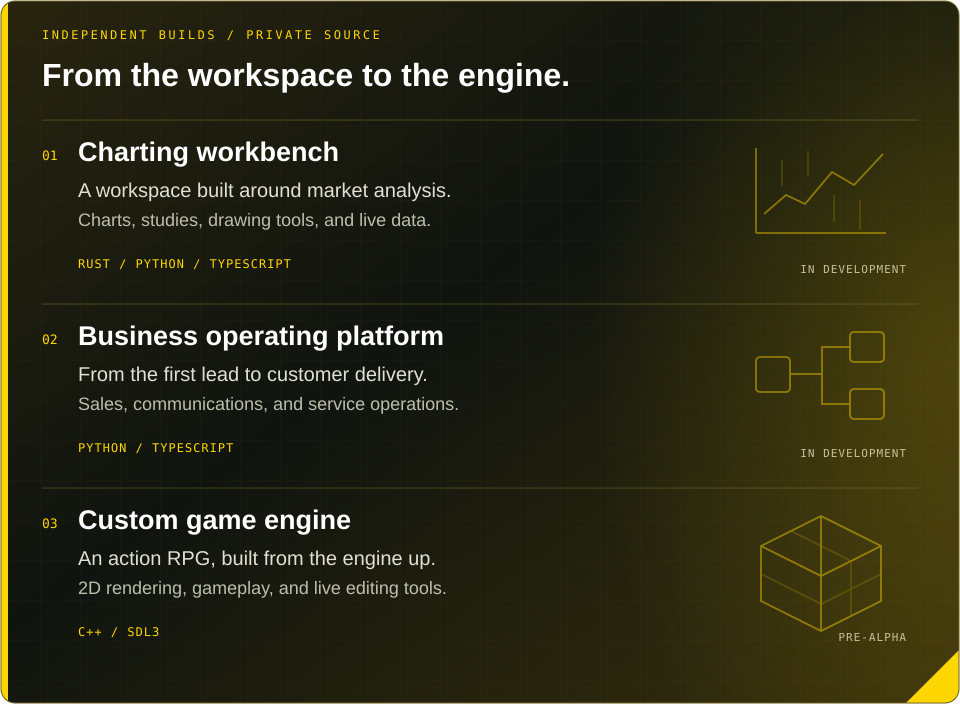
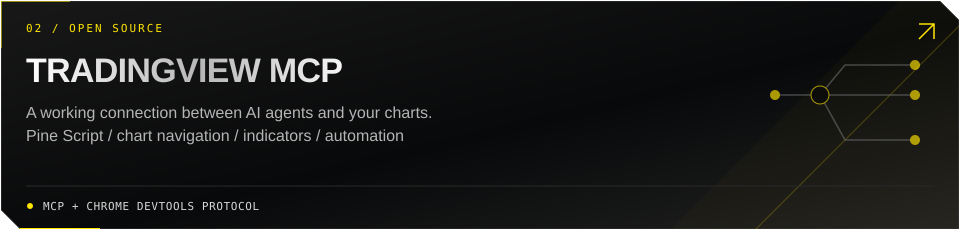
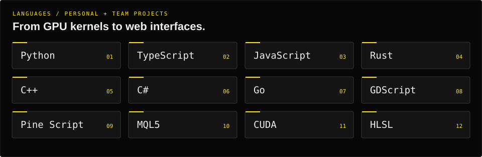
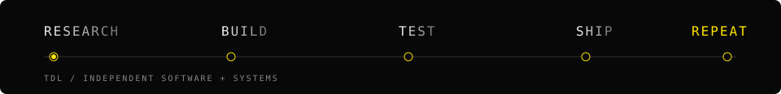

  

  <strong>Co-Founder &amp; Chief Product Officer at <a href="https://thedailyprofiler.com/about">The Daily Profiler</a></strong> 
  I build software for traders, create AI tools, and help a team turn ideas into working products.

  <a href="#the-daily-profiler">PRODUCT PORTFOLIO</a> &nbsp; / &nbsp;
  <a href="#open-source-flagship">TRADINGVIEW MCP</a> &nbsp; / &nbsp;
  <a href="#languages--tooling">LANGUAGES + TOOLING</a>

## The Daily Profiler

**From market research to the tools a trading business runs on.** My work spans hands-on development, product direction, and guiding implementation with the team across the organization.

  <a href="https://thedailyprofiler.com/products"><strong>Explore the products ↗</strong></a> &nbsp; · &nbsp;
  <a href="https://thedailyprofilerbootcamp.com"><strong>Visit Bootcamp ↗</strong></a> &nbsp; · &nbsp;
  <a href="https://thedailyprofiler.com/about"><strong>Meet the team ↗</strong></a>

<strong>Product areas &amp; screenshots</strong>

The portfolio includes customer products, internal tools, active development, and experiments. Proprietary source and research stay private.

- **Market Intelligence:** Daily / weekly profiling. Candle analysis. Dashboards, indicators, and replay.
- **Research + Strategy:** Backtesting, risk, and strategy workbenches. Validation and trading integrations.
- **Platform + Data:** Market data, shared datasets, and compute. Reusable services, identity, and tooling.
- **Trader + Business Apps:** Journaling, performance review, and CRM. Accounting and community workflows.
- **Education + Media:** Bootcamp, curriculum, and lesson studios. Video production and rendering.
- **AI + Automation:** Agents, memory, planning, and skills. Content and publishing workflows.

**Inside Candle Science & Enterprise Journal**

 

  

Official public product screenshots. Dashboard figures are demonstration content, not my personal trading results.

## Independent builds

Alongside The Daily Profiler, I build tools for market analysis, business operations, and game development.

Project descriptions &amp; technology

- **Charting workbench:** Charts, studies, drawing tools, and live data in a custom market-analysis workspace. Rust, Python, and TypeScript. In development.
- **Business operating platform:** Sales, customer delivery, communications, and service operations. Python and TypeScript. In development.
- **Custom game engine:** A 2D action RPG on my own C++ engine, with rendering and live editing tools. C++ and SDL3. Pre-alpha.

## Open-source flagship

**6,700+ GitHub stars.** Connects Claude Code to a locally running TradingView Desktop session through MCP and Chrome DevTools Protocol. [Explore the code](https://github.com/tradesdontlie/tradingview-mcp) · [Research notes](https://github.com/tradesdontlie/tradingview-mcp/blob/HEAD/RESEARCH.md)

Independent and unofficial. Chart interaction and research only; it does not execute real trades.

## Languages & tooling

Across my personal and team projects—public and private. This reflects the codebases I build in and help guide, rather than a ranking by public commit count.

- **Web & templates:** HTML, CSS, SCSS, Astro, MDX, Jinja, Mako.
- **Data & shaders:** SQL, PL/pgSQL, GDShader.
- **Scripting & automation:** Shell, PowerShell, Windows Batch, VBScript.
- **Build & deployment:** CMake, Makefiles, Dockerfiles.

  

ANDREW BABCOCK &nbsp; / &nbsp; <strong>TRADESDONTLIE</strong> &nbsp; / &nbsp; <a href="https://thedailyprofiler.com">THE DAILY PROFILER</a>

