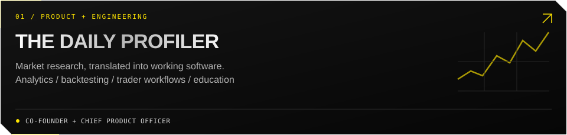
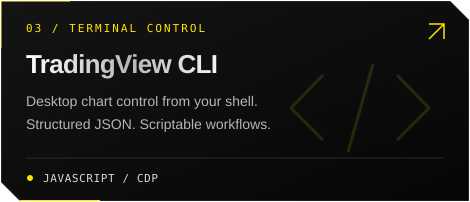
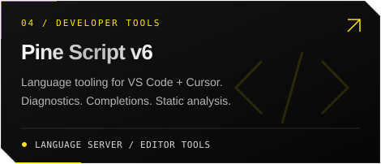
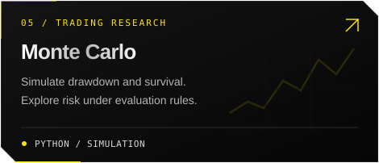
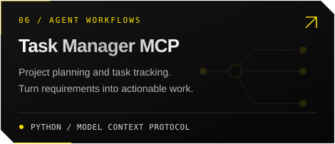

  

  <strong>Co-Founder & Chief Product Officer at <a href="https://thedailyprofiler.com/about">The Daily Profiler</a></strong> 
  I turn trading methodologies into software—and build the tools that let AI work alongside it.

  <a href="https://thedailyprofiler.com">THE DAILY PROFILER</a> &nbsp; / &nbsp;
  <a href="https://github.com/tradesdontlie/tradingview-mcp">TRADINGVIEW MCP</a> &nbsp; / &nbsp;
  <a href="https://github.com/tradesdontlie?tab=repositories&amp;type=source">OPEN SOURCE</a>

## Platforms & systems

My main product work lives at [@thedailyprofiler](https://github.com/thedailyprofiler): historical futures analytics, Candle Science, research and risk tools, journaling, business planning, and Bootcamp. Much of the source is private. [The products are the public window into that work.](https://thedailyprofiler.com)

**6,700+ GitHub stars.** Connects Claude Code to a locally running TradingView Desktop session through MCP and Chrome DevTools Protocol. [Read the research notes](https://github.com/tradesdontlie/tradingview-mcp/blob/HEAD/RESEARCH.md).

Independent and unofficial. Chart interaction and research only; it does not execute real trades.

## Open-source workshop

  
  

  
  

## Beyond the chart

I also work on custom software, business automation, and game-development projects. The common thread: building the underlying systems, the tools around them, and the interface people actually use.

**Python · TypeScript / JavaScript · C# · C++ · Pine Script** 
Trading analytics · MCP servers · Desktop automation · Developer tools · Game development

  

ANDREW BABCOCK &nbsp; / &nbsp; <strong>TRADESDONTLIE</strong> &nbsp; / &nbsp; <a href="https://thedailyprofiler.com">THE DAILY PROFILER</a>

