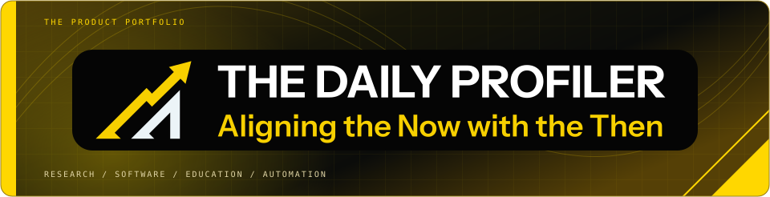
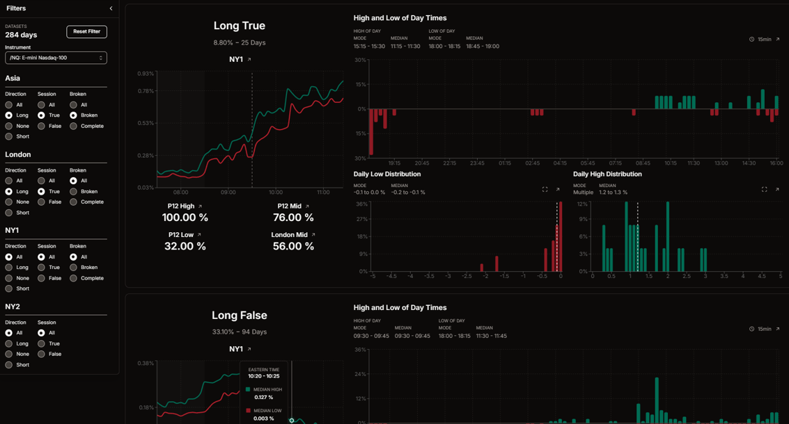
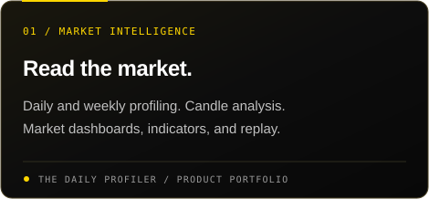
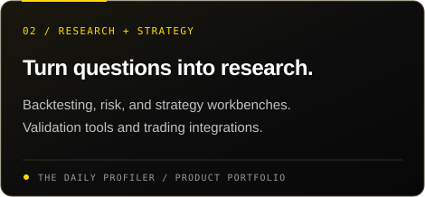
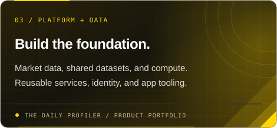
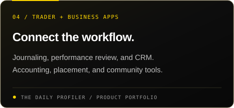
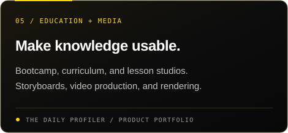
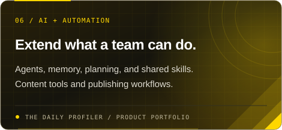

  

  <strong>Co-Founder &amp; Chief Product Officer at <a href="https://thedailyprofiler.com/about">The Daily Profiler</a></strong> 
  I build software for traders, create AI tools, and help a team turn ideas into working products.

  <a href="#the-daily-profiler">PRODUCT PORTFOLIO</a> &nbsp; / &nbsp;
  <a href="#open-source-flagship">TRADINGVIEW MCP</a> &nbsp; / &nbsp;
  <a href="#languages--tooling">LANGUAGES + TOOLING</a>

## The Daily Profiler

  

**From market research to the tools a trading business runs on.** My work spans hands-on development, product direction, and guiding implementation with the team across the organization—not just the repositories where I commit code.

Daily Profiler app · Public product imagery from our website.

These six areas cover our full repository portfolio: customer products, internal tools, active development, and experiments. Most of the source stays private; the scope of the work does not have to.

  
  

  
  

  
  

[Explore the products](https://thedailyprofiler.com/products) · [Bootcamp](https://thedailyprofilerbootcamp.com) · [Meet the team](https://thedailyprofiler.com/about)

<strong>Inside the products: Candle Science &amp; Enterprise Journal</strong>

 

  

Official public product screenshots. Dashboard figures are demonstration content, not my personal trading results.

## More private builds

Outside the organization portfolio, I also work on:

- **A custom charting workbench** — a market-analysis workspace with charts, studies, drawing tools, and live data. Rust, Python, and TypeScript; in development.
- **A business operating platform** — sales, customer delivery, communications, and service operations in one workspace. Python and TypeScript; in development.
- **A custom game engine** — a 2D action RPG built on my own C++ engine, including rendering and live editing tools. C++ and SDL3; pre-alpha.

## Open-source flagship

**6,700+ GitHub stars.** Connects Claude Code to a locally running TradingView Desktop session through MCP and Chrome DevTools Protocol. [Explore the code](https://github.com/tradesdontlie/tradingview-mcp) · [Research notes](https://github.com/tradesdontlie/tradingview-mcp/blob/HEAD/RESEARCH.md)

Independent and unofficial. Chart interaction and research only; it does not execute real trades.

## Languages & tooling

Across my personal and team projects—public and private. This reflects the codebases I build in and help guide, rather than a ranking by public commit count.

- **Web & templates:** HTML, CSS, SCSS, Astro, MDX, Jinja, Mako.
- **Data & shaders:** SQL, PL/pgSQL, GDShader.
- **Scripting & automation:** Shell, PowerShell, Windows Batch, VBScript.
- **Build & deployment:** CMake, Makefiles, Dockerfiles.

  

ANDREW BABCOCK &nbsp; / &nbsp; <strong>TRADESDONTLIE</strong> &nbsp; / &nbsp; <a href="https://thedailyprofiler.com">THE DAILY PROFILER</a>

